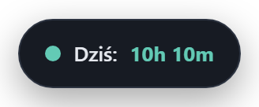
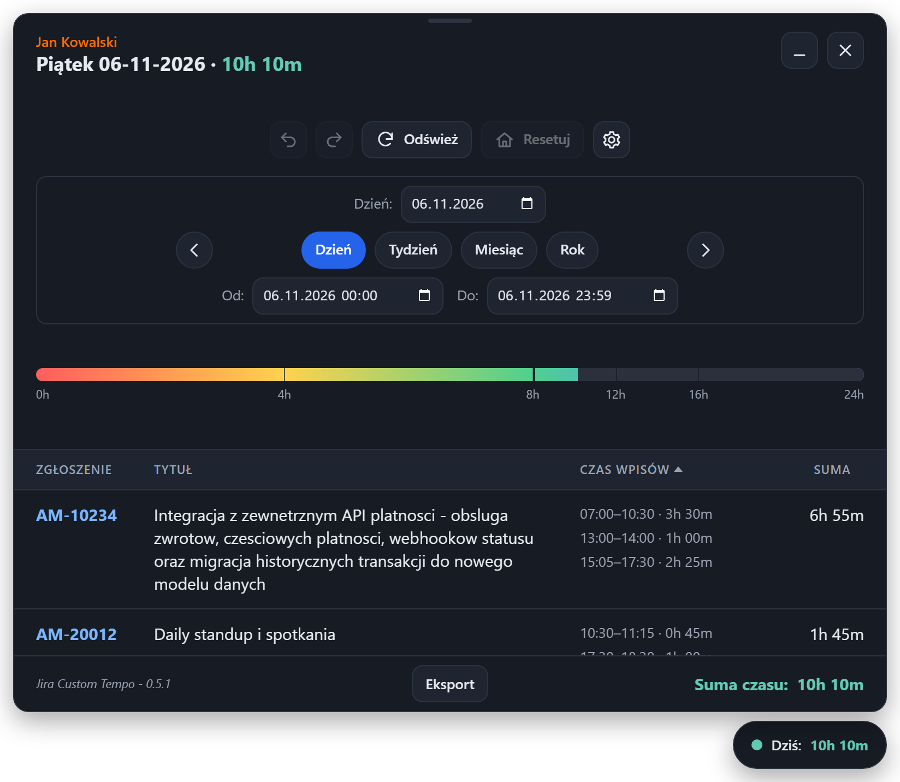
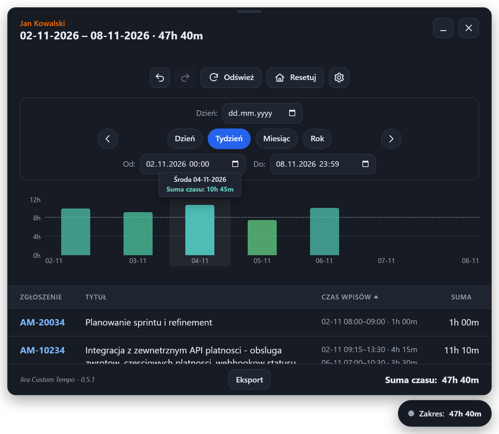
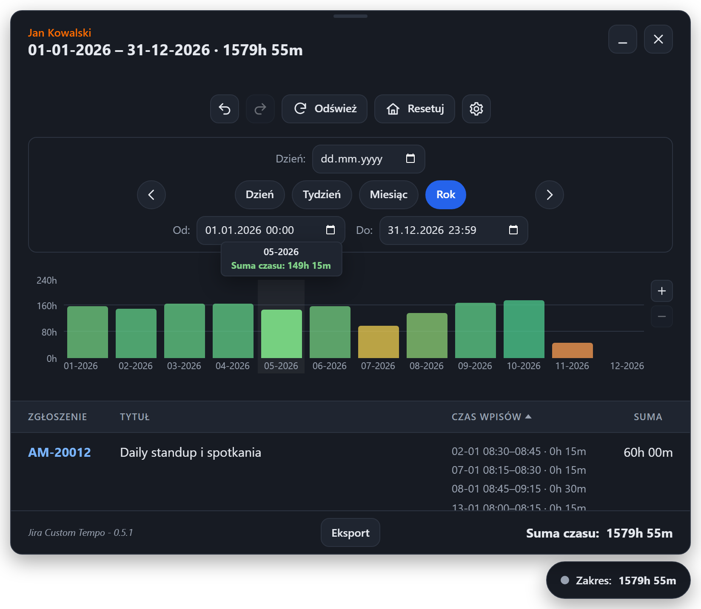
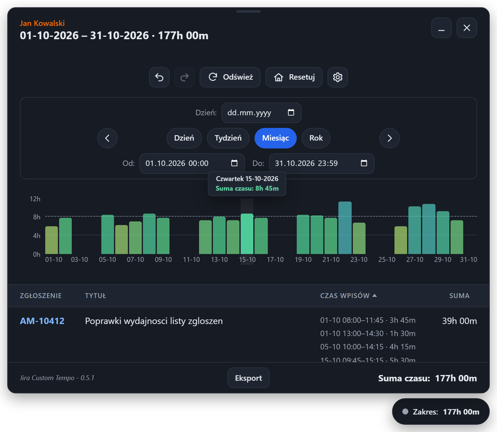
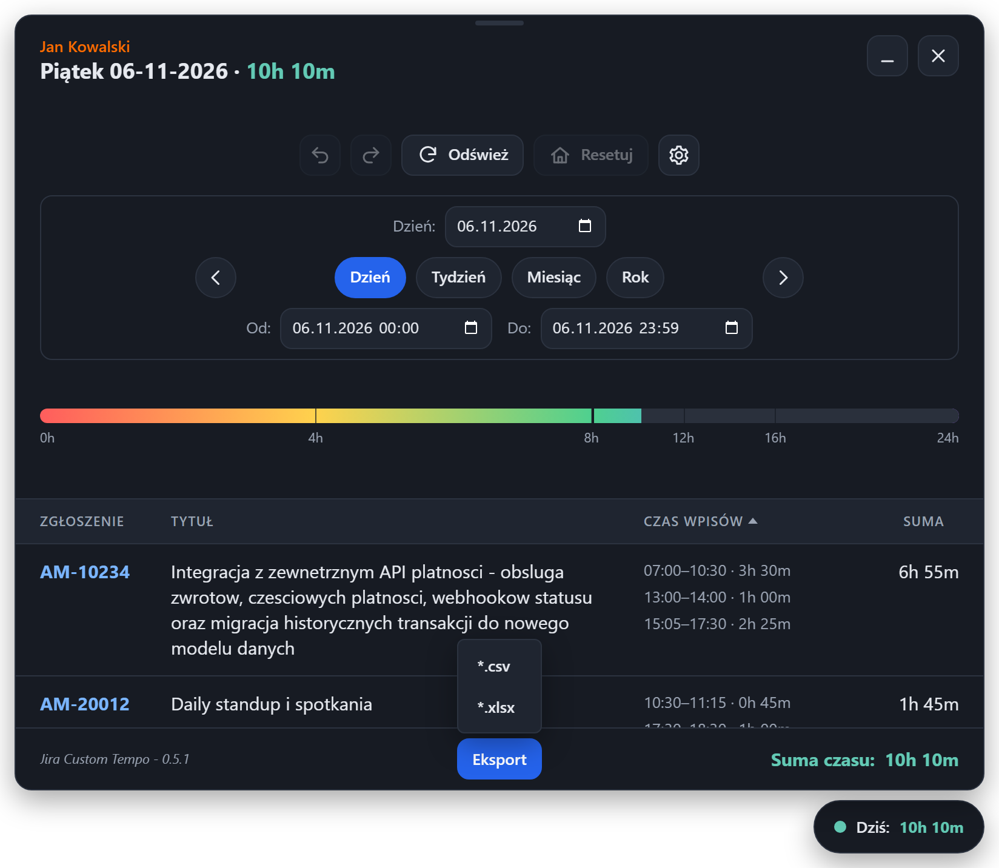
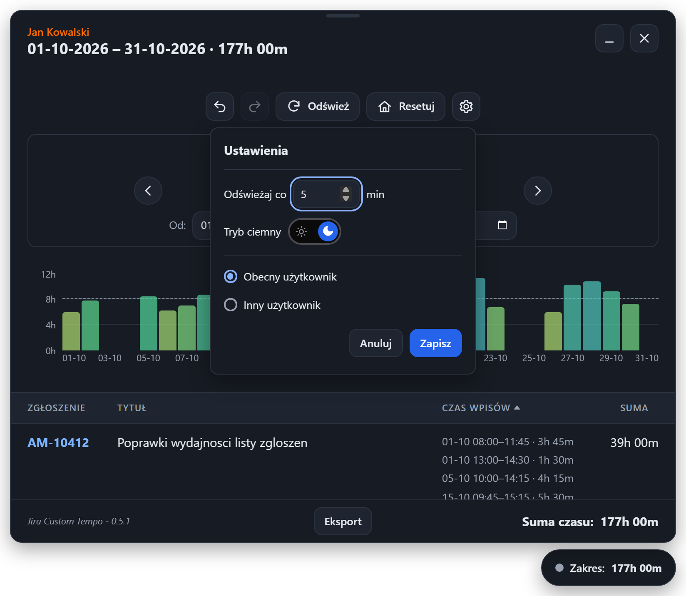
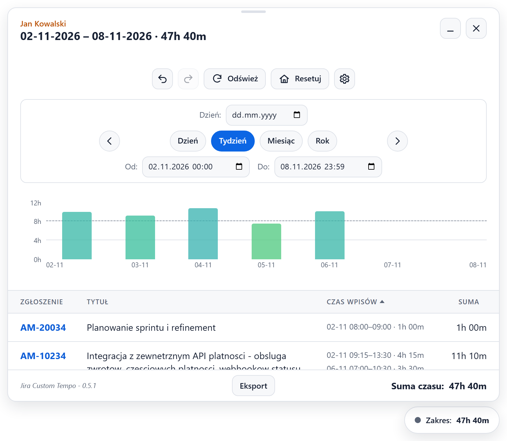

# Jira Custom Tempo

A browser extension that shows you your own logged work time on Jira Cloud, or that of a
colleague you name. The interface is in Polish.

On every Jira page a small button in the bottom-right corner shows today's total ("Dziś:
10h 10m"). Clicking it opens a panel with one row per ticket, every time entry, the sum per
ticket, and the total. For a single day the panel also shows a progress bar against the
8-hour norm; for a longer period, a bar chart of the days, months, or years.

## Screenshots

The pictures show the extension with sample data. `vp run screenshots` takes them again.

**The launcher.** A small button on every Jira page with today's total. A click opens the
panel; you can drag it anywhere.

**One day.** The progress bar against the 8-hour norm (red through yellow to green up to 8
hours, then green through blue to violet up to 24), and a table with one row per ticket: every
time entry and the sum.

**A week.** A period longer than one day shows a bar per day in the same colours, with a
dashed line at 8 hours. Point at a bar for its date and total; click it to see only that day.

**A year.** Longer periods show a bar per month. The plus button, the plus key, or Ctrl
with the mouse wheel zooms in to single days.

**A month, after a click on its bar.** The days come from the data already loaded, with no
new request to Jira. "Cofnij" and "Ponów" (the curved arrows) go back and forward through
the views; the round arrows beside the rows move to the previous and next month.

**Export.** "Eksport" in the total row saves the table as a CSV or as an XLSX file.

**Settings.** The auto-refresh interval and the dark / light switch.

**The light appearance.**

## What you get

- **Launcher**: today's total on every Jira page, coloured like the progress bar. When you
  select another period in the panel it shows that one: a date, or "Zakres:" for a range.
  Drag it anywhere in the window; it remembers its place.
- **Panel**: any single day ("Dzień:"), the buttons "Dzień", "Tydzień", "Miesiąc", "Rok" for
  the current day, week, month, and year, round arrow buttons at both sides that move to the
  previous and next one, and a custom range with date and time. The table sorts by any column. Minimising the panel with the launcher or the minimise button keeps the
  selected period; the close button starts again on today, and so does "Resetuj" without
  closing the panel. The panel hangs on the launcher:
  above it, or below it when the launcher is near the top. Drag its edges or its corner to set
  its height and width.
- **Chart**: a period longer than one day shows one bar per day (up to 31 days), per month,
  or per year (more than 24 months), in the colours of the progress bar. Point at a bar for
  its date and total. Zoom in with the buttons, the plus key, or Ctrl and the mouse wheel to
  see single days. Click a bar to see only its month or day; that uses the data already
  loaded and does not ask Jira again.
- **Header in two rows**: the top row has the name, the title with the total, and the two
  window buttons at the right, minimise and close. Under it a toolbar holds "Cofnij",
  "Ponów", "Odśwież", "Resetuj", and the settings, in the middle. The layout is the same on
  a phone; there "Odśwież" and "Resetuj" show their signs only. The panel is at least 592 px
  high where the window has room for it.
- **Total row**: at the foot of the panel, the name of the add-on with its version at the
  left ("Jira Custom Tempo - 0.5.1"), "Eksport" in the middle while the table has rows, and
  the total at the right. On a phone "Eksport" stands at the left and the name on a line
  below.
- **Back and forward**: "Cofnij" and "Ponów" beside "Odśwież" return to the views you were
  on, up to 10 steps back, without asking Jira again.
- **Refresh**: "Odśwież" reloads the data. Auto-refresh runs every 5 minutes by default.
- **Reset**: "Resetuj" (the house) goes back to today and to your own time and forgets the
  steps of "Cofnij" and "Ponów", as the close button does, but the panel stays open. The
  settings, the size of the panel, the place of the launcher, and the sort order stay as
  they are. The button is switched off while there is nothing to reset.
- **Export**: "Eksport" in the middle of the total row saves the table on screen as a file.
  "*.csv" is a header and one line per ticket, separated by semicolons, which Excel with
  Polish settings opens by itself. "*.xlsx" is a formatted sheet: the name, the period, and
  the total above the table, the columns and colours of the panel, borders, a total row,
  and sums the spreadsheet can add up. The file is named after the person and the period,
  for example `Jan_Kowalski_01-11-2026_30-11-2026_tempo_report.xlsx`. It is made in your
  browser from what is on screen: nothing is asked of Jira and nothing is sent anywhere.
  The control is there only while the table has rows.
- **Settings** (gear): the auto-refresh interval in minutes (0 turns it off), the dark /
  light switch (default dark), and whose time is shown.
- **Another person**: in the settings choose "Inny użytkownik", type a colleague's first
  and last name, and press "Zapisz". The name is checked in Jira first: a name nobody has
  gives an alert and saves nothing; a name several people fit (or a surname alone) gives a
  list to pick from. The panel then shows that person's time, with their name above the
  title and on the launcher. Minimising keeps the person; the close button, "Resetuj", a
  reload of the page, and a new tab return to you. The last person you looked at is offered again
  the next time, so you do not type the name twice. Your own name always stands above the
  title while your own time is shown.

## How it works

- One content script that runs on `https://*.atlassian.net/*` (not on `/wiki/`).
- It reads the Jira REST API of the site you have open, with the Jira session you already have
  in the browser. It never asks for a password, a token, or an address.
- It only reads: every request is a `GET`. It asks the browser for no permissions.
- It draws inside its own isolated element, so it does not change Jira's look, and Jira does
  not change its look.
- No runtime dependencies and no UI framework. The whole script is about 29 kB gzipped.
- Source is TypeScript and SCSS. The toolchain is Vite+ (`vp`), which is mandatory for this
  project.

## Install in Chrome or Edge

1. `vp install`
2. `vp run build`
3. Open `chrome://extensions` or `edge://extensions` and turn on "Developer mode".
4. Choose "Load unpacked" and select the folder `dist/extension`.
5. Open your Jira Cloud site while signed in. The launcher appears in the bottom-right corner.

For people who only use the extension there is a short Polish guide, per browser, in
[BrowserInstallation.md](BrowserInstallation.md). Every build copies it into `dist/extension`,
so it is also inside the zip file.

After a code change: `vp run build`, press the extension's reload button on the extensions
page, and reload the Jira page.

To hand the extension to others, `vp run package` creates
`dist/jira-custom-tempo-<version>.zip`. That file can be uploaded to the Chrome Web Store or
Edge Add-ons, or distributed by a company browser policy. Browsers do not let ordinary users
install an extension from a file in any other way.

## Requirements

| Need | Version |
|------|---------|
| [Vite+](https://viteplus.dev) (`vp`) | 1.2 or later |
| Node.js | 22.18 or later (the project pins 22.23.5 in `.node-version`) |
| Chrome or Edge | A current version |

## Commands

| Command | Does |
|---------|------|
| `vp install` | Installs the pinned dependencies |
| `vp run dev` | Serves a stand-in Jira page with the add-on and a faked Jira at `http://127.0.0.1:5173/`. The sample data is dated 2 to 6 November 2026, so click "Tydzień" and then the previous arrow. |
| `vp test run` | Unit and UI tests. No Jira needed. |
| `vp check` | Format, lint, and type checks (`vp check --fix` repairs formatting) |
| `vp run build` | Builds `dist/extension` (with a copy of `BrowserInstallation.md`), builds the script once more without the export code into `dist-core` (never shipped, only measured), and fails if that core is over 100 kB gzipped. The size of the export code is printed and has no limit (constitution 3.1.0). |
| `vp run test:e2e` | Browser tests: the stand-in page at 320 px, 1280 px, and 1920 px, and the real extension loaded into Chromium |
| `vp run check` | All of the above: the full gate before a merge |
| `vp run package` | Builds and packs the zip file |
| `vp run screenshots` | Takes the pictures of this page again into `docs/screenshots/`, from the stand-in page with a year of sample data (`?scenario=showcase`) |

The browser tests need Chromium once: `npx playwright install chromium`.

## Status

The code, the automated tests, and the size check are complete. The tests load the real built
extension into Chromium and run it against a faked Jira Cloud address.

The installed extension was tried on a real Jira Cloud site on 2026-11-13 for the time of
another person: a colleague's time is shown and matches Jira to the minute, a surname alone
finds the person, and a name nobody has gives the alert. The results are in
`specs/002-other-user-worktime/research.md` (checks X7 to X11; X11, a user without the
"Browse users and groups" permission, was not checked). Checks X1 to X6 in
`specs/001-worktime-panel/research.md` and the walkthrough in
`specs/001-worktime-panel/quickstart.md` have not been recorded one by one yet.

The export is covered by the automated tests, including downloads from the built extension
on a page with a strict content security policy. It has not been tried on a real Jira Cloud
site yet, and the files have not been opened in Microsoft Excel, LibreOffice Calc, and
Google Sheets yet (checks X12 to X14 in `specs/003-table-export/research.md`). Do these
before a release.

## Known limits

- Jira Cloud only, on addresses under `atlassian.net`. A site on a custom domain needs that
  domain added to `extension/manifest.json`.
- Tested in Chromium (Chrome, Edge). Firefox is not tested.
- Most mobile browsers do not support extensions.
- Settings are stored per browser and per Jira site.
- The launcher starts in the bottom-right corner and can cover a small part of the Jira page;
  drag it elsewhere.
- The panel follows the launcher through CSS anchor positioning (Chrome and Edge 125 or
  later). An older browser shows the panel above the launcher only.
- Jira search covers only the 1,000 most recent time entries of a ticket. Older entries on
  very busy tickets can be missed.
- A time entry saved a few seconds ago can be missing from one refresh and appear on the next.
- The "Od:" and "Do:" fields use the browser's own date-time control, so they follow the
  browser's date format.
- Export:
  - The file holds what the table shows: one line or row per ticket, with all its time
    entries in one field or cell. There is no file with one line per time entry.
  - The CSV file is text throughout, without a total. In the XLSX file the sums are
    numbers shown as "6h 55m"; the time entries stay text.
  - The browser decides where the file goes and what it is called when a file of that name
    exists. When the browser blocks downloads, no file appears.
  - A full name longer than 100 characters is not cut: the file name carries the surname
    alone (the last word), or only the dates when that is too long as well.
  - "Odśwież" keeps the keyboard focus while a load runs; it is switched off meanwhile.
- Another person's time:
  - You see what Jira lets you see: time logged on tickets you can view. Looking people up
    needs Jira's "Browse users and groups" permission; without it every name is reported
    as not found.
  - Only people with an active account are found. A deactivated account is reported as not
    found.
  - A name is found from its beginning or from the beginning of one of its words (a
    surname alone works), with or without Polish letters. A text from the middle of a word
    finds nobody.
  - The list of people shows no pictures, and an e-mail address only where Jira shows it to
    you. Two people of the same name with hidden addresses look the same in the list.
  - Days are cut by your own time zone, also for a colleague in another one.
  - The name and account ID of the last person you looked at are kept in the browser, with
    the other settings, until you look at someone else or clear the site's data.

## Project documents

Everything about the panel is in `specs/001-worktime-panel/`, everything about the time of
another person in `specs/002-other-user-worktime/`, and everything about the export in
`specs/003-table-export/`: `spec.md` (requirements), `plan.md`
(design), `research.md` (decisions and open checks), `data-model.md`, `contracts/`,
`quickstart.md`, and `tasks.md`. Project rules are in `.specify/memory/constitution.md`.
