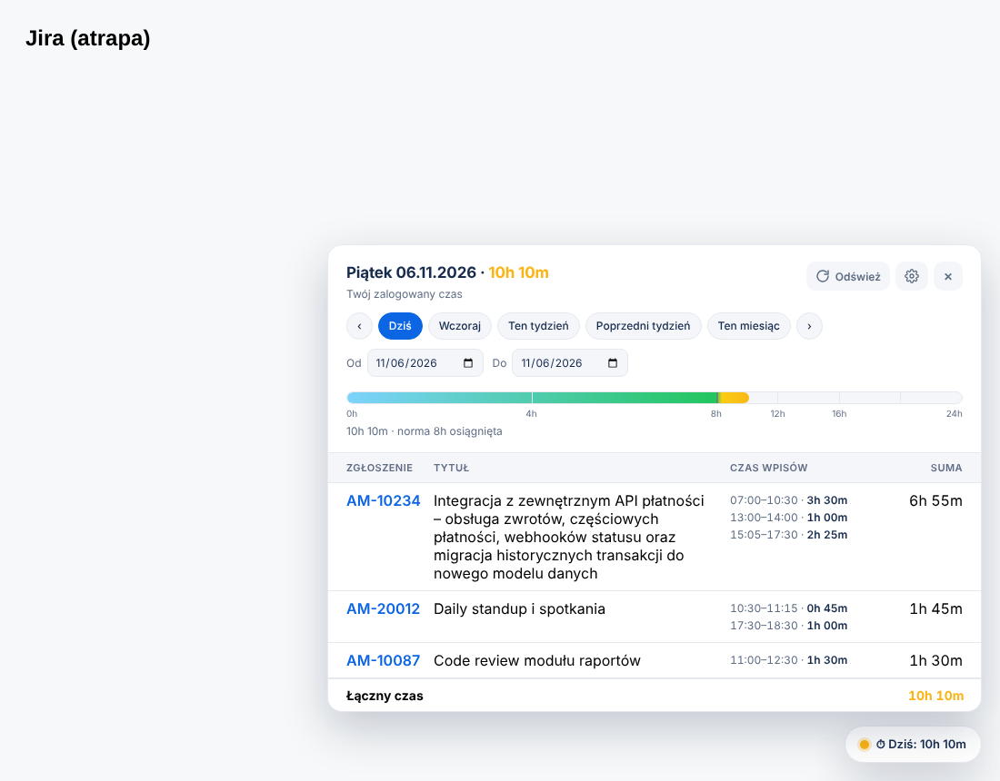

# Feature Specification: Worktime Panel (Jira Custom Tempo)

**Feature Branch**: `001-worktime-panel` (spec directory name; no git branch was created)

**Created**: 2026-11-12

**Status**: Draft

**Input**: User description: "Create jira custom tempo plugin, which will display information about working time of current user login to jira (by webpage)" followed by 13 numbered requirements (table of tickets with time entries, period selection, refresh and auto-refresh setting, Polish title and labels, coloured progress bar and totals, overflow-safe table, 5-minute granularity, inspiration images).

**Amendment 2026-11-12**: "in settings mode add switcher to switch between light and dark mode, default can be dark" (User Story 6, FR-043 to FR-048, SC-010).

**Amendment 2026-11-12 (2)**: "add info we will use jira cloud" (target platform recorded in Assumptions, Dependencies).

**Amendment 2026-11-12 (3)**: "0 means turn off sync change mockup and specification" (User Story 4 scenario 5, FR-030, FR-032, SC-005).

**Amendment 2026-11-12 (4)**: the requester decided that Vite+ is the mandatory development toolchain (recorded in Assumptions, Dependencies; no functional requirement changes).

**Amendment 2026-11-12 (5)**: "change this to a standalone add-on": the plugin is delivered as a browser extension instead of a Jira Cloud app (User Story 5, FR-040 to FR-042, FR-049, FR-050, new FR-052 to FR-054, Assumptions).

**Amendment 2026-11-12 (6)**: twelve usability changes and an icon, requested after the first use: a framed period box of three rows with "Przedwczoraj", a day field, and year presets; "Do" follows a changed "Od"; a fixed panel height; a spinner over the table instead of an emptied table; sortable columns; a hover tip and more space around the progress bar; a faded inactive bar; a right-aligned, coloured total row; a sun-and-moon theme switch; minimising keeps the period; a hover colour on the launcher; the extension icon (User Stories 3, 4, 5, 6; FR-009, FR-014, FR-019, FR-022, FR-025, FR-027, FR-034, FR-041, FR-044, FR-049; new FR-055 to FR-067).

**Amendment 2026-11-12 (7)**: nine changes requested after trying the extension on a real Jira site: the user sets the panel height (default 50% of the window, minimum one visible table row); the launcher moves left, off Jira's own corner button; the launcher names the period the panel is on ("Dziś:", a date, or "Zakres:"); every button has a hover colour and the selected option an inverted one; nothing is written under the progress bar and the norm is no longer mentioned in text; the subtitle is removed; a total of 0h 00m is shown muted everywhere; the theme switch has a blue knob that sits flush at either end; the three rows of the period box are centred and packed (User Stories 2, 5, 6; FR-020, FR-040, FR-044, FR-055, FR-059, FR-065, FR-066; new FR-068 to FR-070).

**Amendment 2026-11-12 (8)**: seven further changes requested after the second try on a real Jira site: the user sets the panel's width too, and both dimensions at the corner (minimum width 640 px, so table cells do not wrap); the period box loses "Dziś", "Przedwczoraj", and the three "Poprzedni …" presets and keeps "Wczoraj", "Ten tydzień", "Ten miesiąc", "Ten rok"; no text cursor in the launcher; the launcher stands level with Jira's own corner button and the panel always stands above it; the user drags the launcher anywhere in the window and the panel hangs on it through CSS anchor positioning, going below the launcher when there is no room above; the range labels read "Od:" and "Do:"; the moon of the theme switch is centred in the knob; the explanation of the refresh interval becomes a tooltip (User Stories 3, 5, 6; FR-022, FR-031, FR-044, FR-055, FR-059, FR-069; new FR-071 to FR-074).

**Amendment 2026-11-13 (9)**: a bar chart for periods longer than one day, requested on 2026-11-13: it stands in place of the progress bar, with one bar per day (up to 31 days), per month (longer periods), or per year (more than 24 months), in the colours of the progress bar; the bars do not touch; a bar under the pointer is drawn at full strength and shows its date and total; the user zooms in to see single days (User Stories 2, 3; FR-019; new FR-076 to FR-079).

**Amendment 2026-11-13 (10)**: selecting a bar of the chart, requested on 2026-11-13: a click on a bar shows only its month (or year, or day): the chart, the title, the fields, and the table follow; a day is shown as a single day with the progress bar. The data comes from what is already loaded, without a new request to Jira (User Story 3; new FR-080, FR-081).

**Amendment 2026-11-13 (11)**: going back and forward through the views, requested on 2026-11-13: two buttons beside "Odśwież", "Cofnij" and "Ponów", return to the previous view and to the one the user came back from, up to 10 steps back, from remembered data; a button with nowhere to go is disabled; both react to the pointer like the other buttons (User Story 3; new FR-082, FR-083).

## Inspiration Images

The two mock-ups supplied with the request are stored with this spec. They show the intended look
and layout. Where a mock-up and the written requirements differ, the written requirements win; the
differences are listed in Assumptions.

- [Panel overview](inspiration/01-panel-overview.png): header with title and total, refresh /
  settings / close buttons, period presets, date range, progress bar, table, total row, collapsed
  launcher.

  

- [Settings popover](inspiration/02-settings-popover.png): auto-refresh interval setting opened
  from the gear button.

  

## Clarifications

### Session 2026-11-12

- Q: Since Jira Cloud cannot show a floating "Dziś: 10h 10m" button on every page, where should that quick-access element live instead? → A: Both: a dashboard gadget that shows today's total and opens the panel page, and a keyboard shortcut with a command-palette entry that opens the panel as a pop-up from any Jira page. (Superseded on 2026-11-12 by the standalone add-on decision below.)
- Q: Should the two settings (auto-refresh interval and light/dark theme) follow you to every browser and device, or is it enough that each browser remembers its own? → A: Each browser remembers its own settings; a new browser or device starts with the defaults, and the app asks for read permission only.
- Q: When you look at a period longer than one day, what should the progress bar and its colours measure the total against? → A: Nothing. For a period longer than one day the progress bar is shown as an inactive light-gray bar with no fill, and the totals use the normal text colour.
- Q: Should the custom range let you pick only whole days, or also a start hour and an end hour? → A: Date and time: "Od" and "Do" each have a date and an hour:minute; entries count when they start inside that exact window.
- Q: What do you mean by "standalone add-on"? → A: A browser extension: installed in the browser once, it shows the panel on top of any Jira Cloud page the user is signed in to and reads their time with their own Jira session.
- Q: What should happen to the existing Jira Cloud app version (Apps-menu page, dashboard gadget, command-palette pop-up)? → A: Replace it. The browser extension is the only form of the plugin.

## User Scenarios & Testing *(mandatory)*

### User Story 1 - See today's logged time per ticket (Priority: P1)

A person logged in to Jira opens the plugin and immediately sees how much time they have logged
today: one row per ticket with the ticket number (a link to the ticket), the ticket title, each
logged time entry with its start and end time, and the sum for that ticket. The title shows the
Polish day of the week, the date, and the total logged time; the same total is repeated below the
table.

**Why this priority**: This is the core value of the plugin. Without it nothing else is useful.
On its own it already answers the daily question "how much have I logged today and on what?".

**Independent Test**: Log time on two tickets today in Jira (one of them twice), open the plugin,
and confirm the rows, entry times, row sums, title, and bottom total match what was logged.

**Acceptance Scenarios**:

1. **Given** the user logged 07:00–10:30 and 13:00–14:00 on AM-10234 and 11:00–12:30 on AM-10087
   today, **When** they open the plugin, **Then** the table shows two rows: AM-10234 with both
   entries one below the other in the same row and "Suma" 4h 30m, and AM-10087 with one entry and
   "Suma" 1h 30m.
2. **Given** the table is shown, **When** the user activates a ticket number, **Then** that Jira
   ticket opens.
3. **Given** today is Friday 6 November 2026 and the total logged time is 6h 00m, **When** the
   plugin is open, **Then** the title reads "Piątek 06-11-2026" followed by "6h 00m", and below
   the table "Suma czasu: 6h 00m" is shown.
4. **Given** the user has logged no time today, **When** they open the plugin, **Then** an empty
   state message in Polish is shown, the total is 0h 00m, and no error is shown.
5. **Given** a ticket whose title is very long, **When** it is shown in the table, **Then** the
   title wraps inside its column, the ticket number stays on one line, and nothing overflows the
   table or the panel.
6. **Given** another user has logged time on the same ticket today, **When** the current user
   opens the plugin, **Then** only the current user's entries are shown and summed.

---

### User Story 2 - Daily norm progress at a glance (Priority: P2)

The user sees a progress bar that shows the total logged time against the 8-hour daily norm, with
room to show overtime up to 24 hours. The colour of the bar tells them where they stand: light
blue towards light green while approaching 8 hours, then yellow through orange to red beyond
8 hours. The total in the title and the total below the table use the same colour as the bar.

**Why this priority**: It turns the numbers into an instant status signal, which is the main
reason to glance at the plugin during the day. It depends on Story 1 for its data.

**Independent Test**: With test data of 2h, 8h, 10h, and 20h logged, confirm the fill length and
colour of the bar and the colour of both totals in each case.

**Acceptance Scenarios**:

1. **Given** 4h 00m is logged today, **When** the plugin is open, **Then** the bar is filled to
   the 4h position with a colour between light blue and light green, and both totals use that
   same colour.
2. **Given** exactly 8h 00m is logged, **When** the plugin is open, **Then** the bar is filled to
   the 8h mark and ends in light green.
3. **Given** 10h 10m is logged, **When** the plugin is open, **Then** the 0–8h part of the bar
   keeps its blue-to-green fill, the part beyond 8h is filled in yellow, and both totals are
   yellow.
4. **Given** 20h 00m is logged, **When** the plugin is open, **Then** the overtime part of the
   bar runs from yellow through orange to red and both totals are red-toned.

---

### User Story 3 - Review other periods (Priority: P2)

The user switches from today to another period with one action: yesterday, the day before
yesterday, any single day picked in the "Dzień:" field, this week, previous week, this month,
previous month, this year, previous year, or a custom range chosen with a start and an end date
and time. The
table, title, and totals update to the chosen period. The progress bar is active only for a
single day; for a longer period a bar chart of the days, months, or years stands in its place.

**Why this priority**: Checking yesterday or the week is the second most common need (filling
gaps, weekly reporting). The plugin is still useful without it.

**Independent Test**: With time logged on several days, select each preset and a custom range,
and confirm the shown entries and totals match the logged data for exactly that period.

**Acceptance Scenarios**:

1. **Given** the plugin was just opened, **When** nothing else is selected, **Then** the period
   is the whole current day and the "Dzień:" field shows today's date.
2. **Given** the user selects "Wczoraj", **When** data loads, **Then** only yesterday's entries
   are shown and the title shows yesterday's Polish day name and date.
3. **Given** today is Thursday, **When** the user selects "Ten tydzień", **Then** entries from
   Monday through Sunday of the current week are included.
4. **Given** "Ten tydzień" is shown, **When** the user presses the previous arrow, **Then**
   entries from Monday through Sunday of the previous week are included.
5. **Given** the user selects "Ten miesiąc", or presses the previous arrow on it, **When** data
   loads, **Then** entries from the first through the last day of that month are included.
6. **Given** the user sets "Od" 02-11-2026 00:00 and "Do" 04-11-2026 23:59, **When** data loads,
   **Then** entries from all three days are included and no preset is highlighted.
7. **Given** the user sets "Od" 06-11-2026 08:00 and "Do" 06-11-2026 12:00 and has entries
   starting at 07:00, 08:00, 11:55, and 12:05 that day, **When** data loads, **Then** only the
   entries starting at 08:00 and 11:55 are shown and summed, each with its full duration.
8. **Given** the user selects any preset, **When** they look at the range fields, **Then** "Od"
   shows the first day of the period at 00:00 and "Do" shows the last day at 23:59.
9. **Given** a period longer than one day, **When** the table is shown, **Then** each ticket
   still has exactly one row, each time entry shows its date as well as its times, and the title
   shows the range instead of a day name.
10. **Given** a period longer than one day, **When** data is shown, **Then** a bar chart with one
    bar per day stands in place of the progress bar, and the total in the title and the total
    below the table are in the normal text colour.
18. **Given** "Ten tydzień" is shown, **When** the user moves the pointer over the bar of a day,
    **Then** that bar is drawn at full strength and a tip names the day and its total.
19. **Given** "Ten rok" is shown, **When** the user looks at the chart, **Then** it has one bar
    per month; **When** they zoom in, **Then** it has one bar per day and scrolls sideways.
20. **Given** a period of more than 24 months, **When** data is shown, **Then** the chart has one
    bar per year, and zooming in shows months and then days.
11. **Given** the user returns from a longer period to a single day, **When** data loads,
    **Then** the progress bar and the coloured totals are active again.
12. **Given** the user sets a "Do" date and time earlier than the "Od" date and time, **When**
    they confirm, **Then** the plugin shows a Polish validation message and keeps the previous
    period.
13. **Given** "Ten tydzień" is shown, **When** the user changes "Od" to 05-11-2026, **Then** "Do"
    becomes 05-11-2026 23:59 by itself and that single day is shown.
14. **Given** the user picks 15-10-2026 in the "Dzień:" field, **When** data loads, **Then** the
    whole of that day is shown, and "Od" and "Do" show 15-10-2026 00:00 and 23:59.
15. **Given** the user selects "Ten rok", **When** data loads, **Then** entries from 1 January
    through 31 December of this year are included, and the arrows move by one year.
16. **Given** "Wczoraj" is shown, **When** the user presses the previous arrow, **Then** the day
    before yesterday is shown, the "Dzień:" field shows its date, and no preset is highlighted.
17. **Given** another day is shown, **When** the user picks today's date in the "Dzień:" field or
    presses the close button and opens the panel again, **Then** today is shown.

---

### User Story 4 - Keep data fresh (Priority: P3)

The user refreshes the data with a refresh button at the top. The plugin also refreshes by itself
when it opens and then at a regular interval. The user opens settings with a gear button and sets
the auto-refresh interval in minutes; the default is 5 minutes and 0 turns auto-refresh off.

**Why this priority**: Freshness matters during the day, but a user can always reopen the plugin,
so this is a convenience on top of Stories 1–3.

**Independent Test**: Log a new time entry in Jira while the plugin is open; confirm it appears
after pressing refresh, and separately that it appears on its own within the configured interval.

**Acceptance Scenarios**:

1. **Given** the plugin is open, **When** the user logs new time in Jira and presses "Odśwież",
   **Then** the new entry appears and all totals and the bar update.
2. **Given** the plugin is opened, **When** it starts, **Then** it loads current data from Jira
   without the user pressing anything.
3. **Given** no interval was ever set, **When** the plugin stays open, **Then** data refreshes
   every 5 minutes.
4. **Given** the user sets the interval to 10 and saves, **When** the plugin stays open, **Then**
   data refreshes every 10 minutes, and the value is still 10 after closing and reopening Jira.
5. **Given** the user sets the interval to 0 and saves, **When** the plugin stays open, **Then**
   data no longer refreshes by itself; it still loads when the plugin is opened and when the
   user presses "Odśwież", and the value is still 0 after closing and reopening Jira.
6. **Given** the settings are open with a changed value, **When** the user presses "Anuluj",
   **Then** the previous interval stays in effect.
7. **Given** a refresh or a change of period is in progress, **When** the user looks at the
   plugin, **Then** a spinner is shown over the table area and the rows loaded before stay on
   screen under it until new data arrives.
8. **Given** a refresh fails, **When** the failure occurs, **Then** a Polish error message is
   shown, the last loaded data stays visible, and the user can retry.

---

### User Story 5 - Quick access from any Jira page (Priority: P3)

On every Jira page a small launcher sits near the corner of the window and shows today's
total (for example "Dziś: 10h 10m") in the progress colour. Once the user selects another
period in the panel, the launcher shows that period instead: another day by its date
("05-11-2026: 1h 15m"), anything longer as "Zakres: 22h 40m". Activating it opens the panel on top of
the Jira page. The launcher again, or the Escape key, minimises the panel and keeps the period
the user selected; the close button closes it, and the next opening starts on today again.
This is the layout of the first mock-up.

**Why this priority**: It makes the total visible without opening anything and the panel
reachable from anywhere, but the panel itself delivers the value.

**Independent Test**: Open any Jira page while signed in and confirm the launcher shows
today's total, opens the panel on today, and that closing the panel leaves the Jira page as it
was.

**Acceptance Scenarios**:

1. **Given** the user is signed in and on any Jira page with the panel closed, **When** they
   look at the launcher, **Then** it shows today's total logged time in the same colour the
   progress bar would have.
2. **Given** the panel is closed, **When** the user activates the launcher, **Then** the panel
   opens on top of the Jira page with the period "Dziś".
3. **Given** the panel is open, **When** the user presses the close button, the Escape key, or
   the launcher, **Then** the panel disappears, the launcher remains, and the Jira page
   underneath is unchanged.
4. **Given** the panel was closed with the close button while showing another period, **When**
   the user opens it again, **Then** it shows "Dziś".
8. **Given** the panel shows "Wczoraj" and was minimised with the launcher or the Escape key,
   **When** the user opens it again, **Then** it still shows "Wczoraj", with fresh data.
9. **Given** the pointer is over the launcher or any other button, **When** the user looks at
   it, **Then** its colour differs from its resting colour; a selected option changes the
   other way round, from filled to outlined.
10. **Given** the panel shows another whole day, **When** the user looks at the launcher,
    **Then** it shows that day's date and total, with the dot in the colour of the total.
11. **Given** the panel shows a period longer than a day or a part of a day, **When** the user
    looks at the launcher, **Then** it shows "Zakres:" and the total, in the normal text colour.
12. **Given** the shown total is 0h 00m, **When** the user looks at the launcher, the title, or
    the total row, **Then** the value (in the total row also its label) and the launcher's dot
    are in the muted colour.
13. **Given** the panel was minimised on another period, **When** time passes, **Then** the
    launcher keeps showing and refreshing that period until the close button is used.
14. **Given** the user drags the top edge of the panel, **When** they release it, **Then** the
    panel keeps that height, also after the page is reloaded.
5. **Given** the launcher is shown and auto-refresh is on, **When** the user logs more time,
   **Then** the launcher's total updates within the auto-refresh interval, whether the panel is
   open or closed.
6. **Given** the user types in a field of the panel, **When** a typed key is also a Jira
   keyboard shortcut, **Then** Jira does not react to it.
7. **Given** nobody is signed in to Jira on the page, **When** the page loads, **Then** the
   plugin shows nothing.

---

### User Story 6 - Choose light or dark appearance (Priority: P3)

The user opens settings with the gear button and uses a switch to choose between the dark and the
light appearance of the plugin. The plugin starts in dark mode until the user chooses otherwise,
and remembers the choice.

**Why this priority**: It is a comfort preference. The plugin delivers its full value in either
appearance, so this comes after the data, period, and refresh stories.

**Independent Test**: Open the plugin for the first time and confirm it is dark; switch to light
in settings, save, reopen Jira, and confirm it is still light and every element is readable.

**Acceptance Scenarios**:

1. **Given** a user who has never changed the setting, **When** they open the plugin, **Then**
   the panel, the settings, and the launcher are shown in dark mode.
2. **Given** the settings are open, **When** the user flips the appearance switch, **Then** the
   plugin changes appearance immediately as a preview.
3. **Given** the user flipped the switch to light, **When** they press "Zapisz", **Then** the
   plugin stays light, and it is still light after closing and reopening Jira.
4. **Given** the user flipped the switch, **When** they press "Anuluj", **Then** the plugin
   returns to the appearance it had before the settings were opened.
5. **Given** either appearance, **When** the plugin shows data, **Then** all text, the table, the
   ticket links, the progress bar colours, and both coloured totals are clearly readable.
6. **Given** the settings are open, **When** the user looks at the switch, **Then** its Polish
   label and its position show which appearance is active: the knob is under the sun for
   light and under the moon for dark.
7. **Given** the settings are open, **When** the user looks at them, **Then** a line separates
   the title "Ustawienia" from the settings, and the switch stands directly after its label.

---

### Edge Cases

- No time logged in the selected period: empty state message, totals 0h 00m, empty progress bar.
- Total above 24h on a single day (overlapping entries): the bar is shown completely filled and
  the totals still show the real value.
- Overlapping entries on the same or different tickets: every entry is listed and summed as
  logged; no entries are merged or removed.
- An entry that crosses midnight: it belongs to the day on which it starts and counts with its
  full duration.
- An entry that starts inside a custom range but ends after "Do": it is included with its full
  duration. An entry that starts before "Od" and ends inside the range: it is not included.
- An entry whose duration is not a multiple of 5 minutes (logged outside the team convention):
  the real logged value is shown and summed, not a rounded one.
- A ticket the user logged time on but can no longer view: its entries are not shown and not
  summed.
- A ticket title with one very long unbroken word: the word is broken so it does not overflow.
- A large period (a full month with many tickets): all rows are shown and scroll inside the
  panel; the header, period controls, and totals stay in view. The panel has one fixed height
  and is never taller than the window.
- A period with few or no rows: the panel keeps its height; the table sits at the top of its
  area and the space below it stays empty.
- Loading a newly selected period fails: the rows of the previous period are removed, so they
  cannot be taken for the new one; the error message and the retry action are shown.
- The user sorts the table and then refreshes or changes the period: the chosen column and
  direction stay.
- Jira is unreachable or the session expired: Polish error message, last loaded data kept,
  retry available.
- The date changes while the plugin is open on "Dziś": the next refresh shows the new day.
- Interval input that is empty, negative, or not a whole number: rejected with a Polish message;
  the previous interval stays in effect.
- Jira itself is shown in a different appearance than the plugin (for example Jira light, plugin
  dark): the plugin keeps the user's own choice and stays readable on top of the Jira page.
- The saved settings cannot be read (first use, a new browser or device, cleared browser data):
  the plugin uses the defaults, dark mode and 5 minutes.
- The settings are closed without "Zapisz" or "Anuluj" after flipping the switch: the change is
  discarded, as with "Anuluj".
- A page of the same site that is not Jira (for example a wiki page): the plugin shows nothing.
- The Jira page navigates to another view without a full reload: the launcher and an open
  panel stay.
- Narrow window: all four columns remain readable without horizontal scrolling of the page.

## Requirements *(mandatory)*

### Functional Requirements

**Data shown**

- **FR-001**: The plugin MUST show only the time entries logged by the user currently logged in
  to Jira, without asking the user to identify themselves again.
- **FR-002**: The plugin MUST show a table with the columns "Zgłoszenie", "Tytuł", "Czas wpisów",
  and "Suma".
- **FR-003**: The table MUST contain exactly one row for each ticket that has at least one time
  entry by the current user in the selected period.
- **FR-004**: "Zgłoszenie" MUST show the Jira ticket number (for example AM-12345) as a link that
  opens that ticket.
- **FR-005**: "Tytuł" MUST show the current title of the ticket.
- **FR-006**: "Czas wpisów" MUST list every time entry of that ticket in the period as a
  start–end time range in 24-hour format (for example 07:00–10:15) together with the duration of
  that entry.
- **FR-007**: When a ticket has more than one time entry, the entries MUST be shown one below the
  other inside the same table row, ordered by start time. Additional table rows MUST NOT be
  created for them.
- **FR-008**: "Suma" MUST show the sum of the durations of all entries listed in that row.
- **FR-009**: Rows MUST be ordered by the start time of their earliest entry in the period,
  until the user chooses another order (FR-063).
- **FR-010**: Durations MUST be shown in hours and minutes (for example 6h 55m). Logged values
  MUST be shown and summed exactly as recorded; the expected granularity is 5 minutes.
- **FR-011**: When the selected period covers more than one day, each time entry MUST also show
  its date.

**Title and totals**

- **FR-012**: For a single-day period the title MUST show the Polish name of the day of the week,
  the date in the format dd-mm-yyyy (for example 02-07-2026), and the total logged time of the
  period. When the period covers only part of that day, the title MUST also show the start and
  end times (for example 08:00–12:00).
- **FR-013**: For a period longer than one day the title MUST show the start and end dates in
  the format dd-mm-yyyy and the total logged time of the period. When the period does not start
  at 00:00 or does not end at 23:59, the title MUST also show the start and end times.
- **FR-051**: A period counts as single-day when "Od" and "Do" fall on the same calendar day,
  whether it covers the whole day or part of it.
- **FR-014**: Below the table the plugin MUST show "Suma czasu:" followed by the total logged
  time of the period. This value MUST always equal the sum of all "Suma" values in the table.
- **FR-062**: The label "Suma czasu:" and its value MUST stand together at the right edge of
  the total row, and the label MUST have the same colour as the value.

**Progress bar and colour**

- **FR-015**: The plugin MUST show a progress bar for the total logged time on a scale from 0 to
  24 hours, with the 8-hour daily norm clearly marked.
- **FR-016**: From 0 to 8 hours the bar fill MUST change gradually from light blue to light
  green.
- **FR-017**: From 8 to 24 hours the additional fill MUST change gradually from yellow through
  orange to red.
- **FR-018**: For a single-day period, the total in the title and the total below the table MUST
  use the same colour as the bar at the current value, and MUST change together with it.
- **FR-019**: For a period longer than one day the progress bar MUST NOT be shown; the bar
  chart of FR-076 stands in its place. The total in the title and the total below the table
  MUST then use the normal text colour. FR-015 to FR-017 apply to single-day periods only.
  (Until Amendment 9 a faded gray bar was shown.)
- **FR-076**: For a period longer than one day the plugin MUST draw a bar chart where the
  progress bar stands for a single day. The horizontal axis is the period in order, one bar
  per day, month, or year, also where nothing was logged; the vertical axis is the logged
  time in hours, labelled in round hours up to the tallest bar. A bar is as tall as the time
  of its day, month, or year; an entry belongs to the day it starts on, as in the table. The
  bars MUST NOT touch. The panel keeps its size.
- **FR-077**: Without zoom, a bar stands for a day when the period has up to 31 days, for a
  calendar month when it is longer and touches up to 24 months, and for a calendar year
  beyond that. The first and the last month or year are cut to the period.
- **FR-078**: The user MUST be able to zoom the chart in and out between years, months, and
  days, as far as the period touches more than one of each; zooming in always reaches single
  days. Zoomed in, the bars keep a width that can be read and pointed at, and the chart
  scrolls sideways, staying on the same part of the period. Zoom is offered as two buttons,
  with the plus and minus keys, and with Ctrl and the mouse wheel around the pointer. A
  refresh keeps the zoom; another period starts without it.
- **FR-079**: A bar MUST have the colour the progress bar has at its value: a day by its
  total, a month or a year by its average per working day (Monday to Friday), so that the
  colours mean the same at every zoom. The chart of days MUST mark the 8-hour norm with a
  line. Bars are drawn at 75% strength; the bar under the pointer, or chosen with the arrow
  keys, is drawn at 100% and a tip above it shows what it stands for (a day as in the title,
  a month as mm-yyyy, a year as yyyy) and "Suma czasu:" with its total.
- **FR-080**: A click on a bar of the chart, or Enter or Space on the bar chosen with the
  arrow keys, MUST select the part of the period that bar stands for: the year, the month, or
  the day, cut to the period like the bar itself. The title, the "Dzień:", "Od:" and "Do:"
  fields, the pressed preset, the chart, the table, the totals, and the launcher MUST follow
  as for any other change of period. A selected day is a single-day period: the progress bar
  and only that day's entries. A bar without logged time can be selected too.
- **FR-081**: Selecting a bar MUST NOT send a request to Jira while the selected part lies
  inside the period that was loaded last: its entries are taken from that load, and the
  screen changes at once, without the loading state. Further bars selected inside the same
  load (a month of a year, then a day of that month) are served the same way. "Odśwież" and
  auto-refresh load the period on screen from Jira as before, and from then on that load is
  the one bars are served from. Every other change of period (presets, arrows, fields) loads
  from Jira as before.
- **FR-082**: The header MUST have two buttons before "Odśwież": "Cofnij" returns to the
  view the user was on before the current one, "Ponów" to the view the user went back from.
  A view is a period; every change of period by the user is a step: a preset, an arrow, the
  "Dzień:", "Od:" and "Do:" fields, and a bar of the chart. A refresh, an automatic refresh,
  and choosing the period that is already shown are not steps. At most 10 steps back MUST
  be kept; older ones are forgotten. A new step taken after going back discards the views
  that "Ponów" would have reached. A button with nowhere to go MUST be disabled and look
  disabled; an enabled one MUST react to the pointer like the other header buttons. The
  close button forgets all steps (as it forgets the period, FR-064); minimising keeps them.
  The steps are not kept after the page is reloaded.
- **FR-083**: Going back or forward MUST show a view that was loaded as it was shown last,
  with its entries, chart, and totals, at once and without a request to Jira. A view that
  never finished loading is loaded. The zoom of the chart and the sort order of the table
  are not part of a view. The view on screen is refreshed as before by "Odśwież" and by
  auto-refresh.
- **FR-020**: Nothing MUST be written under the progress bar, and no text of the plugin may
  mention the norm; the 8-hour mark on the bar's scale is its only sign. (Until Amendment 7 a
  caption under the bar stated the total and whether the norm was reached.)

- **FR-058**: While the pointer is over the progress bar, the plugin MUST show a tip of two
  lines in a font smaller than the title: the period exactly as the title names it, and
  "Suma czasu:" with the total in the progress colour.
- **FR-066**: The progress bar with its scale MUST stand midway between the period box and the
  table, with the same space above and below (24 px).
- **FR-068**: A total of 0h 00m MUST be shown in the muted colour wherever it appears: in the
  title, in the total row (label and value), in the tip of the progress bar, and on the
  launcher (value and dot).

**Period selection**

- **FR-021**: When opened, the plugin MUST show the current day (whole day) by default.
- **FR-022**: The user MUST be able to select these periods with a single action: "Wczoraj",
  "Ten tydzień", "Ten miesiąc", "Ten rok". A year runs from 1 January to 31 December. Every
  other day, week, month, or year is reached with the arrows, the "Dzień:" field, or "Od:" and
  "Do:". (Until Amendment 8 there were also "Dziś", "Przedwczoraj", "Poprzedni tydzień",
  "Poprzedni miesiąc", and "Poprzedni rok".)
- **FR-055**: Everything that selects the period MUST stand in one box with a light frame, in
  three rows, each centred and packed with equal gaps: (1) previous arrow, the "Dzień:" field,
  next arrow; (2) "Wczoraj", "Ten tydzień", "Ten miesiąc", "Ten rok"; (3) "Od:" and "Do:".
- **FR-057**: The "Dzień:" field MUST let the user pick one calendar day, without a time, and
  MUST then show that whole day (00:00 to 23:59). It MUST show the day whenever the period is
  exactly one whole day, and be empty otherwise.
- **FR-023**: The user MUST be able to set a custom range with a start ("Od") and an end ("Do"),
  each made of a date and a time in hours and minutes. A time entry belongs to the range when
  its start time is at or after "Od" and at or before "Do"; it then counts with its full
  duration.
- **FR-024**: The plugin MUST indicate which preset is active, and MUST show the active period
  in the "Od" and "Do" fields. For a preset, "Od" is the first day at 00:00 and "Do" is the last
  day at 23:59.
- **FR-025**: The user MUST be able to move to the previous or next period of the same length.
  A whole calendar month moves by one month and a whole calendar year by one year.
- **FR-026**: Weeks MUST run from Monday to Sunday. Day boundaries MUST follow the user's local
  time zone.
- **FR-056**: When the user changes "Od", "Do" MUST follow it by itself: to the same calendar
  day when "Od" was moved to another day (keeping the time of "Do"), and to 23:59 of that day
  when "Od" would otherwise be later than "Do". Changing "Od" therefore always gives a
  single-day period and is never rejected.
- **FR-027**: A range whose "Do" date and time is changed to earlier than its "Od" date and
  time MUST be rejected with a Polish message.

**Refresh and settings**

- **FR-028**: The plugin MUST load data from Jira when it is opened.
- **FR-029**: A refresh button at the top MUST reload the data for the currently selected period.
- **FR-030**: The plugin MUST reload the data automatically at the configured interval while it
  is open, unless auto-refresh is turned off.
- **FR-031**: A gear button at the top MUST open settings where the user sets the auto-refresh
  interval in whole minutes, with save and cancel actions.
- **FR-032**: The default interval MUST be 5 minutes. A value of 0 MUST turn auto-refresh off;
  loading on open (FR-028) and the refresh button (FR-029) MUST keep working. The settings MUST
  explain this in Polish next to the field ("0 = automatyczne odświeżanie wyłączone (domyślnie
  5 min)").
- **FR-033**: The saved interval MUST be remembered in the browser where it was saved, between
  sessions. A browser with no saved value MUST use the default.
- **FR-034**: A refresh MUST NOT change the selected period, and MUST NOT clear data already on
  screen before new data has arrived.
- **FR-060**: While data is loading, for a refresh and for a newly selected period alike, the
  rows already loaded MUST stay on screen and a spinner MUST be shown over the table area.
  While a newly selected period loads, the title MUST name the new period and show "…" in
  place of its total. If that load fails, the rows of the previous period MUST be removed.

**Presentation**

- **FR-035**: All visible text (labels, buttons, messages, day names, tooltips) MUST be in
  Polish.
- **FR-036**: No text may overflow its table cell, the table, or the panel. Ticket numbers MUST
  stay on one line; ticket titles MUST wrap within their column.
- **FR-037**: The plugin MUST show distinct loading, empty, and error states, each with Polish
  text.
- **FR-038**: The plugin MUST be fully usable on phone and desktop screen widths without
  horizontal scrolling of the page.
- **FR-039**: The visual design MUST follow the supplied inspiration images in layout and style.

- **FR-059**: The panel MUST keep one height whatever it shows, and the user MUST be able to
  set that height by dragging the panel's free horizontal edge, the one away from the launcher
  (the top edge by default), or with the arrow keys on it. The default is 50% of the window
  height. The height MUST NOT go below what shows one table row (440 px) nor above what the
  window allows. The chosen height MUST be remembered in the browser like the other settings;
  a double click on the edge returns to the default.
- **FR-071**: The user MUST be able to set the panel's width in the same way at its free side
  edge (the left edge by default), and both dimensions at once at the corner between the two
  free edges. The default width is 800 px. The width MUST NOT go below 640 px, at which ticket
  numbers, entry times, and sums each stay on one line and the rows of the period box do not
  wrap, nor above what the window allows. The chosen width MUST be remembered; a double click
  on the side edge returns to the default width, on the corner to the default size.
- **FR-061**: When the rows do not fill the table area, the table MUST sit at the top of the
  area and the rest MUST stay empty; the total row stays at the bottom of the panel.
- **FR-063**: Each of the four column headers MUST sort the table by its column: ascending on
  the first activation, descending on the next. "Zgłoszenie" sorts by project and then by
  number as a number; "Tytuł" alphabetically by Polish rules; "Czas wpisów" by the start of the
  earliest entry; "Suma" by the row sum. The active column MUST show its direction. The chosen
  order MUST stay when data is refreshed or the period changes.

**Quick access**

- **FR-040**: A launcher MUST be shown on every Jira page of a signed-in user and MUST open the
  panel when activated. It MUST show the total of the period the panel is on, with a label:
  "Dziś:" for today (also before the panel was ever opened and after the close button), the
  date (dd-mm-yyyy) for another whole day, "Zakres:" for anything else. The value and the dot
  MUST use the same colour rule as the panel's totals: the progress colour for a single day,
  the normal text colour for a longer period, muted for zero.
- **FR-069**: By default the launcher MUST leave the bottom-right corner itself free (88 px
  from the right edge), so that it does not cover Jira's own floating button there, and MUST
  stand level with that button: its middle 48 px above the bottom edge of the window.
- **FR-072**: The user MUST be able to move the launcher anywhere in the window by dragging it
  (or with Shift and the arrow keys); it MUST stay wholly inside the window, and its place MUST
  be remembered in the browser. A press that does not move it is a click. The panel MUST hang
  on the launcher, positioned with CSS anchor positioning: its bottom-right corner just above
  the launcher's top-right corner, so the panel is always clear of the launcher. When the
  panel has no room above the launcher it MUST go below it, hanging from the launcher's
  bottom-right corner; when it has no room to the left it MUST line up with the launcher's
  left edge instead.
- **FR-075**: The panel and the launcher MUST always be wholly inside the window together,
  without covering each other, wherever the launcher is and whatever size was chosen. The
  panel is placed in this order: above the launcher, else below it; with its right edge in
  line with the launcher's, else its left edge, else anywhere inside the window. When the
  chosen height fits on neither side of the launcher, the panel MUST become lower by itself,
  as low as the larger of the two sides allows, also below 440 px; the chosen height stays
  remembered and comes back when there is room. A panel lower than its content scrolls as a
  whole. The side MUST be chosen afresh whenever the launcher moves or the window changes
  size, so the panel returns to the launcher's edge as soon as it fits there again. (Requested
  on 2026-11-12 as a correction of Amendment 8: a large panel could cover
  the launcher or leave the window.)
- **FR-074**: The launcher MUST NOT show a text cursor, and its text MUST NOT be selectable.
- **FR-041**: The panel MUST open on top of the current Jira page and MUST have a close button.
  The close button, the Escape key, and the launcher MUST each hide it and leave the Jira page
  as it was.
- **FR-064**: Hiding the panel with the launcher or the Escape key is minimising: the selected
  period MUST be kept, and the next opening MUST show it again with freshly loaded data.
- **FR-049**: The panel MUST open on the period "Dziś" on a newly loaded page and after it was
  closed with the close button.
- **FR-065**: The launcher and every other button MUST change colour while the pointer is over
  them (a tinted background and an accent border). A selected option and the primary button,
  which are filled, MUST change the other way round: to an outline with coloured text.
- **FR-070**: The header MUST show the title only; there is no subtitle.
- **FR-052**: The plugin MUST NOT change the look or behaviour of the Jira page outside its own
  launcher and panel, and Jira's styles MUST NOT change the look of the plugin.
- **FR-053**: Keys typed inside the plugin MUST NOT trigger Jira's keyboard shortcuts.
- **FR-054**: When nobody is signed in to Jira on the page, the plugin MUST show nothing.

**Installation**

- **FR-042**: The plugin MUST be installable by the user in their own browser, without a Jira
  administrator. After installation it MUST work on the next Jira page with no further setup.

**Appearance**

- **FR-043**: The plugin MUST offer a dark and a light appearance. Each MUST cover the whole
  plugin: panel, table, progress bar, settings, launcher, and all messages.
- **FR-044**: The settings opened with the gear button MUST contain a switch, labelled in Polish,
  that selects the dark or the light appearance and shows which one is active. The switch
  MUST show a sun on its left and a moon on its right, with a round knob in the accent
  (blue) colour that slides under the active one and sits at the same distance from the edge
  at either end, and MUST stand directly after its label, at the left. Each icon MUST be
  centred in the knob when the knob is under it. A dividing line MUST separate the title
  "Ustawienia" from the settings below it.
- **FR-073**: The explanation of the interval ("0 = automatyczne odświeżanie wyłączone
  (domyślnie 5 min)") MUST NOT be written in the settings; it MUST show as a tooltip while the
  pointer is over "Odświeżaj co", the field, or "min", and MUST be available to screen readers
  as the description of the field.
- **FR-045**: The default appearance MUST be dark for every user who has not saved a choice.
- **FR-046**: Flipping the switch MUST change the appearance immediately as a preview. "Zapisz"
  MUST keep it; "Anuluj" or closing the settings MUST restore the previous appearance.
- **FR-047**: The saved appearance MUST be remembered in the browser where it was saved, between
  sessions, and MUST be applied from the first moment the plugin is shown.
- **FR-050**: The plugin MUST NOT modify anything in Jira: it only reads. It MUST NOT ask the
  user for a password, a token, or a Jira address, and MUST NOT ask the browser for any
  permission beyond running on Jira pages.
- **FR-048**: In both appearances the progress colours (light blue, light green, yellow, orange,
  red) MUST keep their meaning, and all text, including the coloured totals, MUST remain clearly
  readable against its background.

**Icon**

- **FR-067**: The extension MUST carry its own icon (a clock with an arrow over a timeline), in
  the sizes the browser asks for: 16, 32, 48, and 128 px.

### Key Entities

- **Time entry (wpis czasu)**: one piece of work logged by the user on a ticket. It has the
  ticket it belongs to, the person who logged it, a start date and time, and a duration. Its end
  time is start plus duration.
- **Ticket (zgłoszenie)**: a Jira ticket with a number (for example AM-12345), a title, and a
  link. One ticket has zero or more time entries by the current user in a period.
- **Period (okres)**: a range from a start date and time to an end date and time, to the
  minute, both inclusive. A preset covers whole days; a custom range can start and end at any
  minute. It determines which time entries are shown.
- **Period summary**: total logged time in the period and, for a single-day period only, the
  8-hour norm and the resulting progress colour.
- **User settings**: the auto-refresh interval in minutes, the chosen appearance (dark or
  light), and the panel height the user set, stored in the user's browser, separately for
  each browser.

## Success Criteria *(mandatory)*

### Measurable Outcomes

- **SC-001**: A user sees today's logged time per ticket and the daily total within 3 seconds of
  opening the plugin, with no input required.
- **SC-002**: For any period, every row sum and the overall total match the time logged in Jira
  for that user to the minute, in 100% of checked cases.
- **SC-003**: A user switches to any preset period with one action and sees its data within
  3 seconds.
- **SC-004**: A user can tell whether they are below, at, or above the 8-hour norm within
  2 seconds of looking at the plugin, from colour and bar alone.
- **SC-005**: Time logged in Jira elsewhere appears in the open plugin within the configured
  auto-refresh interval (when auto-refresh is on), or immediately after pressing refresh.
- **SC-006**: With ticket titles up to 255 characters, no text is cut off or overflows at any
  screen width from 320 px to 1920 px.
- **SC-007**: 100% of visible text is in Polish.
- **SC-008**: A person who installs the plugin can use it immediately, with zero configuration
  steps after installation.
- **SC-009**: A month with 200 time entries across 60 tickets is displayed completely and
  remains scrollable and responsive.
- **SC-010**: A user changes the appearance in at most 3 actions (gear, switch, save), the change
  is visible in under 1 second, and it is still in effect in 100% of later sessions in the same browser.

## Assumptions

**Where the written requirements and the mock-ups differ (written requirements applied)**

- Date format is dd-mm-yyyy with hyphens (the mock-up shows dots).
- The label below the table is "Suma czasu:" (the mock-up shows "Łączny czas").
- "Od" and "Do" each take a date and a time (the mock-up shows date-only fields).

**Corrected by the requester on 2026-11-12**

- An auto-refresh value of 0 turns auto-refresh off, exactly as the settings mock-up states.
  The earlier written line "0 = means default 5min" no longer applies.

**Choices made for Amendment 6 (2026-11-12)**

- The panel height and the space around the progress bar chosen here were replaced by
  Amendment 7 (FR-059, FR-066).
- The request said "Do" follows "Od" when the new "Od" is earlier than "Do". The rule is
  applied to every change of "Od" that leaves the two on different days, and also when "Od"
  would pass "Do" on the same day; otherwise that case would only produce an error.
- Escape counts as minimising, like the launcher: only the close button forgets the period.
- The panel is 800 px wide (it was 760 px), so the six presets of the second row fit on one
  line.
- Below 600 px width the table has no visible column headers, so sorting is available on wider
  screens only; the order chosen there is kept.
- The theme switch follows the look of the "Switch Mode" component of the Watermelon UI
  catalogue (sun, moon, sliding knob), rebuilt without its libraries.
- The icon is the drawing supplied by the requester.

**Choices made for Amendment 7 (2026-11-12)**

- "Configurable height" is done by dragging the top edge of the panel, not by a number in the
  settings: the user sees the result while choosing.
- The lowest height, 440 px, is what the header, the period box, the bar, the column headers,
  one row of one or two lines, and the total row need together.
- A part of a day counts as "Zakres:" on the launcher, because its total is not the total of
  that day.
- For a period longer than a day the launcher's dot is muted, like the totals of such a period:
  there is no progress colour for such a period.
- The launcher is 88 px from the right edge at every window width.
- The 8-hour mark on the scale of the bar stays; only the texts about the norm are gone.

**Choices made for Amendment 8 (2026-11-12)**

- Without the "Dziś" button, today is reached with the "Dzień:" field, the next arrow, or the
  close button followed by the launcher. The other removed presets are one press of the
  previous arrow away from the preset that stays.
- The narrowest panel is 640 px. Titles are free text and still wrap; ticket numbers, entry
  times, and sums do not.
- The grips are on the edges away from the launcher, because those are the edges that move:
  the panel is fixed to the launcher at the opposite corner. When the panel goes below or to
  the other side of the launcher, the grips change sides with it.
- While an edge is dragged the panel grows only up to the window's edge on that side.
- The launcher's place is stored as its distance from the right and bottom edges of the
  window, so it keeps its corner when the window is resized.
- Moving the launcher by keyboard uses Shift with the arrow keys (16 px a press); the arrow
  keys alone stay with the page.
- The gap between the launcher and the panel is 8 px.
- In a window too narrow for the panel beside either edge of the launcher (a phone), the
  panel stays inside the window, above or below the launcher.
- Only the height is reduced by the window: the panel stands above or below the launcher, so
  its width never competes with the launcher for room and is limited by the window alone.
- The side of the launcher is decided in script and the place is taken from the launcher's
  box by CSS anchor positioning. The browser's own fallback list (`position-try-fallbacks`)
  was tried first and dropped: the browser keeps the last side that fitted for as long as it
  still fits, so after the window was made narrow and wide again the panel stayed away from
  the launcher.
- A browser without CSS anchor positioning (Chrome and Edge have had it since version 125)
  places the panel from the launcher's two offsets: above or below it, right edges in line.
- The reported text cursor in the launcher was not reproduced. It is what a browser draws in
  a focused element when caret browsing is on (F7), so the launcher now hides the cursor and
  refuses text selection.
- The moon is a crescent, heavier at its lower left; besides the exact centring of its box it
  is shifted by 6% of its size up and to the right, so that it looks centred.

**Choices made for Amendment 9 (2026-11-13)**

- "Do zakresu 1 miesiąca" is read as up to 31 days, the longest month. "Powyżej każdy miesiąc
  osobno" holds up to 24 months; "jeżeli ktoś ustawiłby lata" is read as more than 24 months,
  so that two years still show their 24 months.
- A month or a year has no norm of its own. Its bar is coloured by the average per working
  day, which keeps blue to green for "up to 8 hours a day" and yellow to red for more.
- Days without logged time have an empty place in the chart, and their tip says 0h 00m.
- The chart is drawn with plain elements and styles; no chart library is added.
- The chart is taller than the progress bar. Its height follows the panel's (64 px in the
  lowest panel, up to 150 px), and the table part keeps room for one row.
- Zoom has buttons because a wheel alone would take the scrolling away from the page; the
  wheel zooms only with Ctrl, which is also what a pinch on a touchpad sends.
- The labels under the bars are thinned out when the bars are narrow, so they do not overlap.

**Choices made for Amendment 10 (2026-11-13)**

- Only a selected bar is served from the loaded data. A preset, an arrow, or a field always
  asks Jira, so that these never show data older than the last refresh without saying so.
- The data of a selected bar is as old as the load it comes from; the next auto-refresh or
  "Odśwież" renews it.
- There is no "back" control: the wider period is reached with a preset, the arrows, or the
  fields, as before.
- A bar cut by the period (a first or last month, or a first day that starts at 10:00) selects
  only the part inside the period.
- On a touch screen the first tap on a bar selects it; its tip is not shown first.

**Choices made for Amendment 11 (2026-11-13)**

- The buttons carry curved arrows, so they are not taken for the straight arrows of the
  period box, which move to the previous and next period.
- "Chyba 10 to max" is read as 10 steps back, so 11 views are remembered with the current one.
- A remembered view is as old as its last load; nothing marks that. The next auto-refresh or
  "Odśwież" renews it.
- No keyboard shortcut is added: Alt with the arrows belongs to the browser's own history.
- In a narrow window the five header buttons do not fit beside the title; the title gets a
  line of its own above them.

**Taken from the mock-ups, not from the written list**

- Each time entry shows its own duration next to its time range.
- Previous / next period arrows, the launcher with today's total, and the close button.
- Wording of secondary texts, for example "Odśwież", "Ustawienia",
  "Odświeżaj co … min", "Anuluj", "Zapisz".

**Defaults chosen where the request was silent**

- The data source is the standard Jira work log of each ticket (time, start, and author as
  recorded by Jira).
- "Ten miesiąc itd." was read as: add "Poprzedni miesiąc" as a further preset (removed again
  by Amendment 8; the previous arrow reaches it).
- An entry crossing midnight is counted fully on its start day.
- The accepted auto-refresh range is 0 to 1440 minutes, whole numbers only (0 = off).
- With auto-refresh off, the launcher's total for today also updates only on open and on manual
  refresh.
- "Default can be dark" is read as: the default appearance is dark.
- The appearance is the user's explicit choice only. The plugin does not follow the appearance
  of Jira or of the device, and there is no "automatic" option.
- The appearance switch previews immediately and is confirmed with "Zapisz", like the
  auto-refresh interval in the same settings.
- The mock-ups show the light appearance only. The dark appearance is designed to match them in
  layout, spacing, and hierarchy; the switch is added to the settings shown in the second
  mock-up.
- The daily norm is fixed at 8 hours and is not configurable in this version.
- The plugin is read-only: logging, editing, and deleting time entries are out of scope.
- Only the current user's time is shown; viewing other people's time and team reports are out of
  scope.
- Export and printing are out of scope.
- The interface is Polish only; other languages are out of scope.
- Ticket numbers are short and of near-constant length (project key plus number, as AM-12345).

**Dependencies**

- The user is logged in to Jira and has permission to view the tickets they logged time on.
- The plugin is a browser extension for Jira Cloud sites (addresses under `atlassian.net`).
  Jira Data Center, Jira Server, and Jira Cloud sites on a custom domain are out of scope.
- It is built for desktop browsers that support standard extensions (Chrome and Edge are
  tested; other browsers are not). Most mobile browsers do not support extensions, so on a
  phone the plugin is available only where the browser does. The layout still adapts down to
  320 px for narrow windows.
- The user installs the extension themselves: from a browser store once it is published
  there, through a company policy, or by loading the extension folder in developer mode.
  Publishing to a store is outside this feature.
- The plugin sees exactly what the signed-in user can see in Jira. It has no access of its
  own.
- The launcher sits in the bottom-right corner of the Jira window and can cover a small part
  of the page there.
- Vite+ is the mandatory development toolchain for this feature and the whole project
  (constitution v2.2.0, Technical Constraints). It is a rule for how the plugin is built and
  tested; it does not change what the user sees, and none of the requirements above depend
  on it.
- The project constitution (`.specify/memory/constitution.md`) applies: minimal size, minimal
  dependencies, responsive layout, consistent modern interface, automated tests, install-only
  setup.
- Conflict to resolve before planning: constitution Principle IV states that light and dark
  themes "MUST follow the host or system preference". User Story 6 instead uses a manual switch
  with dark as the default. The constitution has to be amended to allow this, or the deviation
  has to be recorded and justified in the plan.
