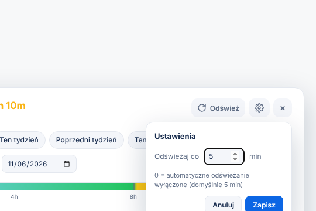

# Feature Specification: Worktime Panel (Jira Custom Tempo)

**Feature Branch**: `001-worktime-panel` (spec directory name; no git branch was created)

**Created**: 2026-11-12

**Status**: Draft

**Input**: User description: "Create jira custom tempo plugin, which will display information about working time of current user login to jira (by webpage)" followed by 13 numbered requirements (table of tickets with time entries, period selection, refresh and auto-refresh setting, Polish title and labels, coloured progress bar and totals, overflow-safe table, 5-minute granularity, inspiration images).

**Amendment 2026-11-12**: "in settings mode add switcher to switch between light and dark mode, default can be dark" (User Story 6, FR-043 to FR-048, SC-010).

**Amendment 2026-11-12 (2)**: "add info we will use jira cloud" (target platform recorded in Assumptions, Dependencies).

**Amendment 2026-11-12 (3)**: "0 means turn off sync change mockup and specification" (User Story 4 scenario 5, FR-030, FR-032, SC-005).

## Inspiration Images

The two mock-ups supplied with the request are stored with this spec. They show the intended look
and layout. Where a mock-up and the written requirements differ, the written requirements win; the
differences are listed in Assumptions.

- [Panel overview](inspiration/01-panel-overview.png): header with title and total, refresh /
  settings / close buttons, period presets, date range, progress bar, table, total row, collapsed
  launcher.

  

- [Settings popover](inspiration/02-settings-popover.png): auto-refresh interval setting opened
  from the gear button.

  

## Clarifications

### Session 2026-11-12

- Q: Since Jira Cloud cannot show a floating "Dziś: 10h 10m" button on every page, where should that quick-access element live instead? → A: Both: a dashboard gadget that shows today's total and opens the panel page, and a keyboard shortcut with a command-palette entry that opens the panel as a pop-up from any Jira page.
- Q: Should the two settings (auto-refresh interval and light/dark theme) follow you to every browser and device, or is it enough that each browser remembers its own? → A: Each browser remembers its own settings; a new browser or device starts with the defaults, and the app asks for read permission only.
- Q: When you look at a period longer than one day, what should the progress bar and its colours measure the total against? → A: Nothing. For a period longer than one day the progress bar is shown as an inactive light-gray bar with no fill, and the totals use the normal text colour.
- Q: Should the custom range let you pick only whole days, or also a start hour and an end hour? → A: Date and time: "Od" and "Do" each have a date and an hour:minute; entries count when they start inside that exact window.

## User Scenarios & Testing *(mandatory)*

### User Story 1 - See today's logged time per ticket (Priority: P1)

A person logged in to Jira opens the plugin and immediately sees how much time they have logged
today: one row per ticket with the ticket number (a link to the ticket), the ticket title, each
logged time entry with its start and end time, and the sum for that ticket. The title shows the
Polish day of the week, the date, and the total logged time; the same total is repeated below the
table.

**Why this priority**: This is the core value of the plugin. Without it nothing else is useful.
On its own it already answers the daily question "how much have I logged today and on what?".

**Independent Test**: Log time on two tickets today in Jira (one of them twice), open the plugin,
and confirm the rows, entry times, row sums, title, and bottom total match what was logged.

**Acceptance Scenarios**:

1. **Given** the user logged 07:00–10:30 and 13:00–14:00 on AM-10234 and 11:00–12:30 on AM-10087
   today, **When** they open the plugin, **Then** the table shows two rows: AM-10234 with both
   entries one below the other in the same row and "Suma" 4h 30m, and AM-10087 with one entry and
   "Suma" 1h 30m.
2. **Given** the table is shown, **When** the user activates a ticket number, **Then** that Jira
   ticket opens.
3. **Given** today is Friday 6 November 2026 and the total logged time is 6h 00m, **When** the
   plugin is open, **Then** the title reads "Piątek 06-11-2026" followed by "6h 00m", and below
   the table "Suma czasu: 6h 00m" is shown.
4. **Given** the user has logged no time today, **When** they open the plugin, **Then** an empty
   state message in Polish is shown, the total is 0h 00m, and no error is shown.
5. **Given** a ticket whose title is very long, **When** it is shown in the table, **Then** the
   title wraps inside its column, the ticket number stays on one line, and nothing overflows the
   table or the panel.
6. **Given** another user has logged time on the same ticket today, **When** the current user
   opens the plugin, **Then** only the current user's entries are shown and summed.

---

### User Story 2 - Daily norm progress at a glance (Priority: P2)

The user sees a progress bar that shows the total logged time against the 8-hour daily norm, with
room to show overtime up to 24 hours. The colour of the bar tells them where they stand: light
blue towards light green while approaching 8 hours, then yellow through orange to red beyond
8 hours. The total in the title and the total below the table use the same colour as the bar.

**Why this priority**: It turns the numbers into an instant status signal, which is the main
reason to glance at the plugin during the day. It depends on Story 1 for its data.

**Independent Test**: With test data of 2h, 8h, 10h, and 20h logged, confirm the fill length and
colour of the bar and the colour of both totals in each case.

**Acceptance Scenarios**:

1. **Given** 4h 00m is logged today, **When** the plugin is open, **Then** the bar is filled to
   the 4h position with a colour between light blue and light green, and both totals use that
   same colour.
2. **Given** exactly 8h 00m is logged, **When** the plugin is open, **Then** the bar is filled to
   the 8h mark, ends in light green, and the caption states that the 8h norm is reached.
3. **Given** 10h 10m is logged, **When** the plugin is open, **Then** the 0–8h part of the bar
   keeps its blue-to-green fill, the part beyond 8h is filled in yellow, and both totals are
   yellow.
4. **Given** 20h 00m is logged, **When** the plugin is open, **Then** the overtime part of the
   bar runs from yellow through orange to red and both totals are red-toned.

---

### User Story 3 - Review other periods (Priority: P2)

The user switches from today to another period with one action: yesterday, this week, previous
week, this month, previous month, or a custom range chosen with a start and an end date and
time. The
table, title, and totals update to the chosen period. The progress bar is active only for a
single day; for a longer period it is shown as an inactive light-gray bar.

**Why this priority**: Checking yesterday or the week is the second most common need (filling
gaps, weekly reporting). The plugin is still useful without it.

**Independent Test**: With time logged on several days, select each preset and a custom range,
and confirm the shown entries and totals match the logged data for exactly that period.

**Acceptance Scenarios**:

1. **Given** the plugin was just opened, **When** nothing else is selected, **Then** the period
   is "Dziś" and covers the whole current day.
2. **Given** the user selects "Wczoraj", **When** data loads, **Then** only yesterday's entries
   are shown and the title shows yesterday's Polish day name and date.
3. **Given** today is Thursday, **When** the user selects "Ten tydzień", **Then** entries from
   Monday through Sunday of the current week are included.
4. **Given** the user selects "Poprzedni tydzień", **When** data loads, **Then** entries from
   Monday through Sunday of the previous week are included.
5. **Given** the user selects "Ten miesiąc" or "Poprzedni miesiąc", **When** data loads, **Then**
   entries from the first through the last day of that month are included.
6. **Given** the user sets "Od" 02-11-2026 00:00 and "Do" 04-11-2026 23:59, **When** data loads,
   **Then** entries from all three days are included and no preset is highlighted.
7. **Given** the user sets "Od" 06-11-2026 08:00 and "Do" 06-11-2026 12:00 and has entries
   starting at 07:00, 08:00, 11:55, and 12:05 that day, **When** data loads, **Then** only the
   entries starting at 08:00 and 11:55 are shown and summed, each with its full duration.
8. **Given** the user selects any preset, **When** they look at the range fields, **Then** "Od"
   shows the first day of the period at 00:00 and "Do" shows the last day at 23:59.
9. **Given** a period longer than one day, **When** the table is shown, **Then** each ticket
   still has exactly one row, each time entry shows its date as well as its times, and the title
   shows the range instead of a day name.
10. **Given** a period longer than one day, **When** data is shown, **Then** the progress bar is
    an inactive light-gray bar with no fill, and the total in the title and the total below the
    table are in the normal text colour.
11. **Given** the user returns from a longer period to "Dziś" or "Wczoraj", **When** data loads,
    **Then** the progress bar and the coloured totals are active again.
12. **Given** the user sets an "Od" date and time later than the "Do" date and time, **When**
    they confirm, **Then** the plugin shows a Polish validation message and keeps the previous
    period.

---

### User Story 4 - Keep data fresh (Priority: P3)

The user refreshes the data with a refresh button at the top. The plugin also refreshes by itself
when it opens and then at a regular interval. The user opens settings with a gear button and sets
the auto-refresh interval in minutes; the default is 5 minutes and 0 turns auto-refresh off.

**Why this priority**: Freshness matters during the day, but a user can always reopen the plugin,
so this is a convenience on top of Stories 1–3.

**Independent Test**: Log a new time entry in Jira while the plugin is open; confirm it appears
after pressing refresh, and separately that it appears on its own within the configured interval.

**Acceptance Scenarios**:

1. **Given** the plugin is open, **When** the user logs new time in Jira and presses "Odśwież",
   **Then** the new entry appears and all totals and the bar update.
2. **Given** the plugin is opened, **When** it starts, **Then** it loads current data from Jira
   without the user pressing anything.
3. **Given** no interval was ever set, **When** the plugin stays open, **Then** data refreshes
   every 5 minutes.
4. **Given** the user sets the interval to 10 and saves, **When** the plugin stays open, **Then**
   data refreshes every 10 minutes, and the value is still 10 after closing and reopening Jira.
5. **Given** the user sets the interval to 0 and saves, **When** the plugin stays open, **Then**
   data no longer refreshes by itself; it still loads when the plugin is opened and when the
   user presses "Odśwież", and the value is still 0 after closing and reopening Jira.
6. **Given** the settings are open with a changed value, **When** the user presses "Anuluj",
   **Then** the previous interval stays in effect.
7. **Given** a refresh is in progress, **When** the user looks at the plugin, **Then** a loading
   indication is visible and the previously loaded data stays on screen until new data arrives.
8. **Given** a refresh fails, **When** the failure occurs, **Then** a Polish error message is
   shown, the last loaded data stays visible, and the user can retry.

---

### User Story 5 - Quick access from any Jira page (Priority: P3)

Jira Cloud does not allow a floating launcher on every page, so quick access has two forms.
On a dashboard, a gadget shows today's total (for example "Dziś: 10h 10m") in the progress
colour and opens the panel page. From any Jira page, a keyboard shortcut or the Jira command
palette opens the panel as a pop-up, which the user closes with a close button. The panel is
also always reachable as a page from Jira's Apps menu.

**Why this priority**: It makes the total visible without opening anything and the panel
reachable from anywhere, but the panel itself delivers the value.

**Independent Test**: Add the gadget to a dashboard and confirm it shows today's total and opens
the panel page. On another Jira page, open the panel with the command palette and with the
shortcut, and close it with the close button.

**Acceptance Scenarios**:

1. **Given** the gadget is on the user's dashboard, **When** they look at it, **Then** it shows
   today's total logged time in the same colour the progress bar would have.
2. **Given** the gadget is shown, **When** the user activates its open action, **Then** the
   panel page opens with the period "Dziś".
3. **Given** the user is on any Jira page, **When** they choose the plugin's entry in the Jira
   command palette or press its keyboard shortcut, **Then** the panel opens as a pop-up over the
   current page with the period "Dziś".
4. **Given** the panel is open as a pop-up, **When** the user presses the close button, **Then**
   the pop-up closes and the Jira page underneath is unchanged.
5. **Given** the panel is open as a page from the Apps menu, **When** the user looks at it,
   **Then** it has no close button.
6. **Given** the gadget is shown and auto-refresh is on, **When** the user logs more time,
   **Then** the gadget's total updates within the auto-refresh interval.

---

### User Story 6 - Choose light or dark appearance (Priority: P3)

The user opens settings with the gear button and uses a switch to choose between the dark and the
light appearance of the plugin. The plugin starts in dark mode until the user chooses otherwise,
and remembers the choice.

**Why this priority**: It is a comfort preference. The plugin delivers its full value in either
appearance, so this comes after the data, period, and refresh stories.

**Independent Test**: Open the plugin for the first time and confirm it is dark; switch to light
in settings, save, reopen Jira, and confirm it is still light and every element is readable.

**Acceptance Scenarios**:

1. **Given** a user who has never changed the setting, **When** they open the plugin, **Then**
   the panel, the settings, and the gadget are shown in dark mode.
2. **Given** the settings are open, **When** the user flips the appearance switch, **Then** the
   plugin changes appearance immediately as a preview.
3. **Given** the user flipped the switch to light, **When** they press "Zapisz", **Then** the
   plugin stays light, and it is still light after closing and reopening Jira.
4. **Given** the user flipped the switch, **When** they press "Anuluj", **Then** the plugin
   returns to the appearance it had before the settings were opened.
5. **Given** either appearance, **When** the plugin shows data, **Then** all text, the table, the
   ticket links, the progress bar colours, and both coloured totals are clearly readable.
6. **Given** the settings are open, **When** the user looks at the switch, **Then** its Polish
   label and its position show which appearance is active.

---

### Edge Cases

- No time logged in the selected period: empty state message, totals 0h 00m, empty progress bar.
- Total above 24h on a single day (overlapping entries): the bar is shown completely filled and
  the totals still show the real value.
- Overlapping entries on the same or different tickets: every entry is listed and summed as
  logged; no entries are merged or removed.
- An entry that crosses midnight: it belongs to the day on which it starts and counts with its
  full duration.
- An entry that starts inside a custom range but ends after "Do": it is included with its full
  duration. An entry that starts before "Od" and ends inside the range: it is not included.
- An entry whose duration is not a multiple of 5 minutes (logged outside the team convention):
  the real logged value is shown and summed, not a rounded one.
- A ticket the user logged time on but can no longer view: its entries are not shown and not
  summed.
- A ticket title with one very long unbroken word: the word is broken so it does not overflow.
- A large period (a full month with many tickets): all rows are shown and the panel scrolls
  inside itself; the header, period controls, and totals stay reachable.
- Jira is unreachable or the session expired: Polish error message, last loaded data kept,
  retry available.
- The date changes while the plugin is open on "Dziś": the next refresh shows the new day.
- Interval input that is empty, negative, or not a whole number: rejected with a Polish message;
  the previous interval stays in effect.
- Jira itself is shown in a different appearance than the plugin (for example Jira light, plugin
  dark): the plugin keeps the user's own choice and stays readable against the Jira page.
- The saved settings cannot be read (first use, a new browser or device, cleared browser data):
  the plugin uses the defaults, dark mode and 5 minutes.
- The settings are closed without "Zapisz" or "Anuluj" after flipping the switch: the change is
  discarded, as with "Anuluj".
- Narrow phone screen: all four columns remain readable without horizontal scrolling of the page.

## Requirements *(mandatory)*

### Functional Requirements

**Data shown**

- **FR-001**: The plugin MUST show only the time entries logged by the user currently logged in
  to Jira, without asking the user to identify themselves again.
- **FR-002**: The plugin MUST show a table with the columns "Zgłoszenie", "Tytuł", "Czas wpisów",
  and "Suma".
- **FR-003**: The table MUST contain exactly one row for each ticket that has at least one time
  entry by the current user in the selected period.
- **FR-004**: "Zgłoszenie" MUST show the Jira ticket number (for example AM-12345) as a link that
  opens that ticket.
- **FR-005**: "Tytuł" MUST show the current title of the ticket.
- **FR-006**: "Czas wpisów" MUST list every time entry of that ticket in the period as a
  start–end time range in 24-hour format (for example 07:00–10:15) together with the duration of
  that entry.
- **FR-007**: When a ticket has more than one time entry, the entries MUST be shown one below the
  other inside the same table row, ordered by start time. Additional table rows MUST NOT be
  created for them.
- **FR-008**: "Suma" MUST show the sum of the durations of all entries listed in that row.
- **FR-009**: Rows MUST be ordered by the start time of their earliest entry in the period.
- **FR-010**: Durations MUST be shown in hours and minutes (for example 6h 55m). Logged values
  MUST be shown and summed exactly as recorded; the expected granularity is 5 minutes.
- **FR-011**: When the selected period covers more than one day, each time entry MUST also show
  its date.

**Title and totals**

- **FR-012**: For a single-day period the title MUST show the Polish name of the day of the week,
  the date in the format dd-mm-yyyy (for example 02-07-2026), and the total logged time of the
  period. When the period covers only part of that day, the title MUST also show the start and
  end times (for example 08:00–12:00).
- **FR-013**: For a period longer than one day the title MUST show the start and end dates in
  the format dd-mm-yyyy and the total logged time of the period. When the period does not start
  at 00:00 or does not end at 23:59, the title MUST also show the start and end times.
- **FR-051**: A period counts as single-day when "Od" and "Do" fall on the same calendar day,
  whether it covers the whole day or part of it.
- **FR-014**: Below the table the plugin MUST show "Suma czasu:" followed by the total logged
  time of the period. This value MUST always equal the sum of all "Suma" values in the table.

**Progress bar and colour**

- **FR-015**: The plugin MUST show a progress bar for the total logged time on a scale from 0 to
  24 hours, with the 8-hour daily norm clearly marked.
- **FR-016**: From 0 to 8 hours the bar fill MUST change gradually from light blue to light
  green.
- **FR-017**: From 8 to 24 hours the additional fill MUST change gradually from yellow through
  orange to red.
- **FR-018**: For a single-day period, the total in the title and the total below the table MUST
  use the same colour as the bar at the current value, and MUST change together with it.
- **FR-019**: For a period longer than one day the progress bar MUST be shown inactive: a
  light-gray bar with no fill and no norm status. The total in the title and the total below
  the table MUST then use the normal text colour. FR-015 to FR-017 apply to single-day periods
  only.
- **FR-020**: For a single-day period the bar MUST show a short Polish caption with the total
  and whether the norm has been reached. For a longer period the caption MUST show the total
  only.

**Period selection**

- **FR-021**: When opened, the plugin MUST show the current day (whole day) by default.
- **FR-022**: The user MUST be able to select these periods with a single action: "Dziś",
  "Wczoraj", "Ten tydzień", "Poprzedni tydzień", "Ten miesiąc", "Poprzedni miesiąc".
- **FR-023**: The user MUST be able to set a custom range with a start ("Od") and an end ("Do"),
  each made of a date and a time in hours and minutes. A time entry belongs to the range when
  its start time is at or after "Od" and at or before "Do"; it then counts with its full
  duration.
- **FR-024**: The plugin MUST indicate which preset is active, and MUST show the active period
  in the "Od" and "Do" fields. For a preset, "Od" is the first day at 00:00 and "Do" is the last
  day at 23:59.
- **FR-025**: The user MUST be able to move to the previous or next period of the same length.
- **FR-026**: Weeks MUST run from Monday to Sunday. Day boundaries MUST follow the user's local
  time zone.
- **FR-027**: A range whose "Od" date and time is later than its "Do" date and time MUST be
  rejected with a Polish message.

**Refresh and settings**

- **FR-028**: The plugin MUST load data from Jira when it is opened.
- **FR-029**: A refresh button at the top MUST reload the data for the currently selected period.
- **FR-030**: The plugin MUST reload the data automatically at the configured interval while it
  is open, unless auto-refresh is turned off.
- **FR-031**: A gear button at the top MUST open settings where the user sets the auto-refresh
  interval in whole minutes, with save and cancel actions.
- **FR-032**: The default interval MUST be 5 minutes. A value of 0 MUST turn auto-refresh off;
  loading on open (FR-028) and the refresh button (FR-029) MUST keep working. The settings MUST
  explain this in Polish next to the field ("0 = automatyczne odświeżanie wyłączone (domyślnie
  5 min)").
- **FR-033**: The saved interval MUST be remembered in the browser where it was saved, between
  sessions. A browser with no saved value MUST use the default.
- **FR-034**: A refresh MUST NOT change the selected period, and MUST NOT clear data already on
  screen before new data has arrived.

**Presentation**

- **FR-035**: All visible text (labels, buttons, messages, day names, tooltips) MUST be in
  Polish.
- **FR-036**: No text may overflow its table cell, the table, or the panel. Ticket numbers MUST
  stay on one line; ticket titles MUST wrap within their column.
- **FR-037**: The plugin MUST show distinct loading, empty, and error states, each with Polish
  text.
- **FR-038**: The plugin MUST be fully usable on phone and desktop screen widths without
  horizontal scrolling of the page.
- **FR-039**: The visual design MUST follow the supplied inspiration images in layout and style.

**Quick access**

- **FR-040**: A dashboard gadget MUST show today's total logged time in the progress colour and
  MUST open the panel page when activated.
- **FR-041**: The panel MUST be openable from any Jira page as a pop-up, both from the Jira
  command palette and with a keyboard shortcut. The pop-up MUST have a close button; the panel
  opened as a page MUST NOT have one.
- **FR-049**: The panel MUST always be reachable as a page from Jira's Apps menu, and MUST
  behave identically as a page and as a pop-up.

**Installation**

- **FR-042**: After installation the plugin MUST work with no further setup by the user or an
  administrator.

**Appearance**

- **FR-043**: The plugin MUST offer a dark and a light appearance. Each MUST cover the whole
  plugin: panel, table, progress bar, settings, gadget, and all messages.
- **FR-044**: The settings opened with the gear button MUST contain a switch, labelled in Polish,
  that selects the dark or the light appearance and shows which one is active.
- **FR-045**: The default appearance MUST be dark for every user who has not saved a choice.
- **FR-046**: Flipping the switch MUST change the appearance immediately as a preview. "Zapisz"
  MUST keep it; "Anuluj" or closing the settings MUST restore the previous appearance.
- **FR-047**: The saved appearance MUST be remembered in the browser where it was saved, between
  sessions, and MUST be applied from the first moment the plugin is shown.
- **FR-050**: The plugin MUST NOT modify anything in Jira. It MUST ask for read access only.
- **FR-048**: In both appearances the progress colours (light blue, light green, yellow, orange,
  red) MUST keep their meaning, and all text, including the coloured totals, MUST remain clearly
  readable against its background.

### Key Entities

- **Time entry (wpis czasu)**: one piece of work logged by the user on a ticket. It has the
  ticket it belongs to, the person who logged it, a start date and time, and a duration. Its end
  time is start plus duration.
- **Ticket (zgłoszenie)**: a Jira ticket with a number (for example AM-12345), a title, and a
  link. One ticket has zero or more time entries by the current user in a period.
- **Period (okres)**: a range from a start date and time to an end date and time, to the
  minute, both inclusive. A preset covers whole days; a custom range can start and end at any
  minute. It determines which time entries are shown.
- **Period summary**: total logged time in the period and, for a single-day period only, the
  8-hour norm and the resulting progress colour.
- **User settings**: the auto-refresh interval in minutes and the chosen appearance (dark or
  light), stored in the user's browser, separately for each browser.

## Success Criteria *(mandatory)*

### Measurable Outcomes

- **SC-001**: A user sees today's logged time per ticket and the daily total within 3 seconds of
  opening the plugin, with no input required.
- **SC-002**: For any period, every row sum and the overall total match the time logged in Jira
  for that user to the minute, in 100% of checked cases.
- **SC-003**: A user switches to any preset period with one action and sees its data within
  3 seconds.
- **SC-004**: A user can tell whether they are below, at, or above the 8-hour norm within
  2 seconds of looking at the plugin, from colour and bar alone.
- **SC-005**: Time logged in Jira elsewhere appears in the open plugin within the configured
  auto-refresh interval (when auto-refresh is on), or immediately after pressing refresh.
- **SC-006**: With ticket titles up to 255 characters, no text is cut off or overflows at any
  screen width from 320 px to 1920 px.
- **SC-007**: 100% of visible text is in Polish.
- **SC-008**: A person who installs the plugin can use it immediately, with zero configuration
  steps after installation.
- **SC-009**: A month with 200 time entries across 60 tickets is displayed completely and
  remains scrollable and responsive.
- **SC-010**: A user changes the appearance in at most 3 actions (gear, switch, save), the change
  is visible in under 1 second, and it is still in effect in 100% of later sessions in the same browser.

## Assumptions

**Where the written requirements and the mock-ups differ (written requirements applied)**

- Date format is dd-mm-yyyy with hyphens (the mock-up shows dots).
- The label below the table is "Suma czasu:" (the mock-up shows "Łączny czas").
- "Od" and "Do" each take a date and a time (the mock-up shows date-only fields).

**Corrected by the requester on 2026-11-12**

- An auto-refresh value of 0 turns auto-refresh off, exactly as the settings mock-up states.
  The earlier written line "0 = means default 5min" no longer applies.

**Taken from the mock-ups, not from the written list**

- Each time entry shows its own duration next to its time range.
- Previous / next period arrows, and the idea of a compact element with today's total plus a
  close button (realised as described in User Story 5).
- Wording of secondary texts, for example "Twój zalogowany czas", "Odśwież", "Ustawienia",
  "Odświeżaj co … min", "Anuluj", "Zapisz".

**Defaults chosen where the request was silent**

- The data source is the standard Jira work log of each ticket (time, start, and author as
  recorded by Jira).
- "Ten miesiąc itd." is read as: add "Poprzedni miesiąc" as a further preset.
- An entry crossing midnight is counted fully on its start day.
- The accepted auto-refresh range is 0 to 1440 minutes, whole numbers only (0 = off).
- With auto-refresh off, the gadget's total for today also updates only on open and on manual
  refresh.
- "Default can be dark" is read as: the default appearance is dark.
- The appearance is the user's explicit choice only. The plugin does not follow the appearance
  of Jira or of the device, and there is no "automatic" option.
- The appearance switch previews immediately and is confirmed with "Zapisz", like the
  auto-refresh interval in the same settings.
- The mock-ups show the light appearance only. The dark appearance is designed to match them in
  layout, spacing, and hierarchy; the switch is added to the settings shown in the second
  mock-up.
- The daily norm is fixed at 8 hours and is not configurable in this version.
- The plugin is read-only: logging, editing, and deleting time entries are out of scope.
- Only the current user's time is shown; viewing other people's time and team reports are out of
  scope.
- Export and printing are out of scope.
- The interface is Polish only; other languages are out of scope.
- Ticket numbers are short and of near-constant length (project key plus number, as AM-12345).

**Dependencies**

- The user is logged in to Jira and has permission to view the tickets they logged time on.
- The target platform is Jira Cloud. The plugin is built, packaged, and installed as a Jira Cloud
  app. Jira Data Center and Jira Server are out of scope.
- On Jira Cloud an app can only appear in the places Jira Cloud offers to apps. A floating
  launcher on every Jira page is not possible; User Story 5 uses a dashboard gadget and a
  command-palette entry with a keyboard shortcut instead.
- The command-palette entry and keyboard shortcut rely on a Jira Cloud capability that
  Atlassian still labels "Preview". If Atlassian changes or withdraws it, the gadget and the
  Apps menu page remain.
- The project constitution (`.specify/memory/constitution.md`) applies: minimal size, minimal
  dependencies, responsive layout, consistent modern interface, automated tests, install-only
  setup.
- Conflict to resolve before planning: constitution Principle IV states that light and dark
  themes "MUST follow the host or system preference". User Story 6 instead uses a manual switch
  with dark as the default. The constitution has to be amended to allow this, or the deviation
  has to be recorded and justified in the plan.
